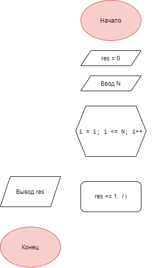

# Домашнее задание

Вариант 20

## Условие задачи

Вычислите вещественное значение **1 + 1 / 2 + 1 / 3 + … + 1 / N** для целого **N**, заданного пользователем.

---
## 1. Алгоритм и блок-схема

### Алгоритм

1. Начало
2. Объявить переменные:
   - `N` (целое число) - конечная точка, задаётся пользователем.
   - `res = 0` (с плавающей точкой) для накопления суммы
3. Запросить у пользователя и считать `N`.
4. Инициализировать цикл `for` со счетчиком `i` от 1 до `N` с шагом 1.
5. На каждой итерации цикла вычислить новое значение суммы: `res += 1.0 / i`.
6. После выхода из цикла вывести итоговое `res`

### Блок-схема




## 2. Реализация программы


## 3. Результаты работы программы

```
input int: 5
0.000000 + 1/1 = 1.000000
1.000000 + 1/2 = 1.500000
1.500000 + 1/3 = 1.833333
1.833333 + 1/4 = 2.083333
2.083333 + 1/5 = 2.283333
output: 2.283333
```

## 4. Информация о разработчике

- **ФИО:** Лавлинский Алексей Евгеньевич
- **Группа:** бОТИ-261, 2п/г
